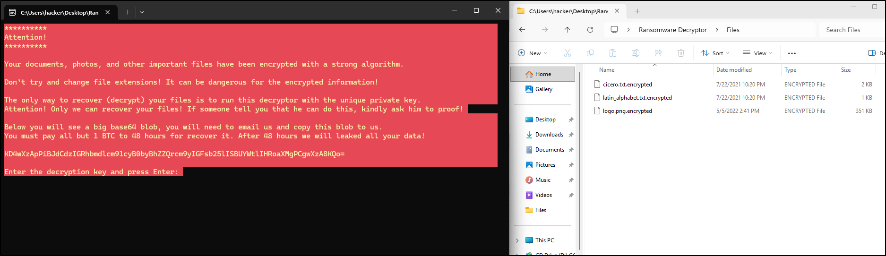
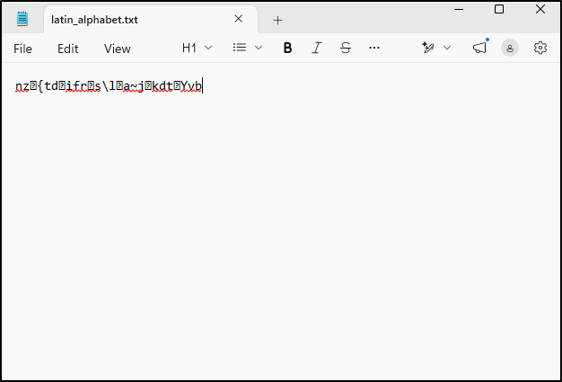
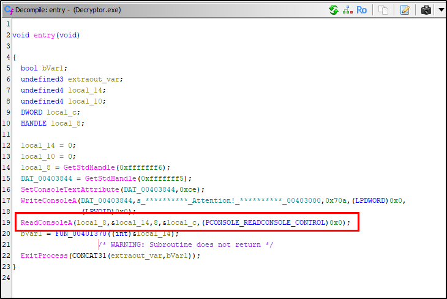
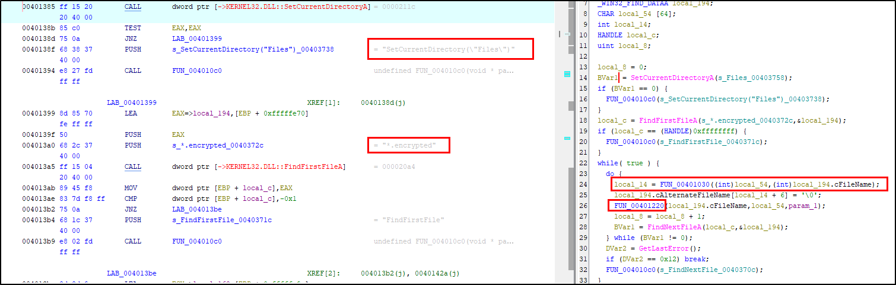
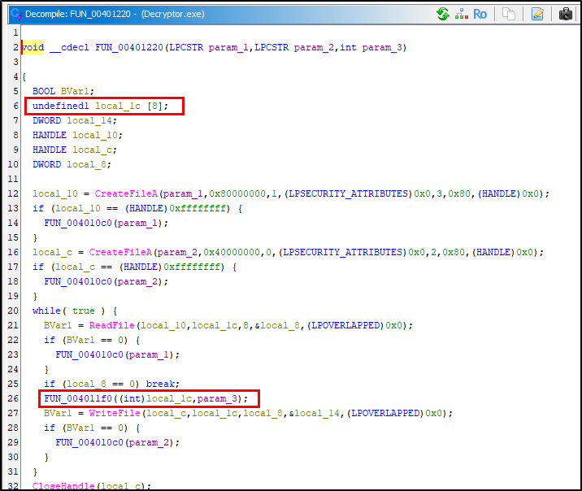
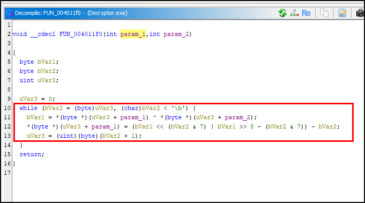
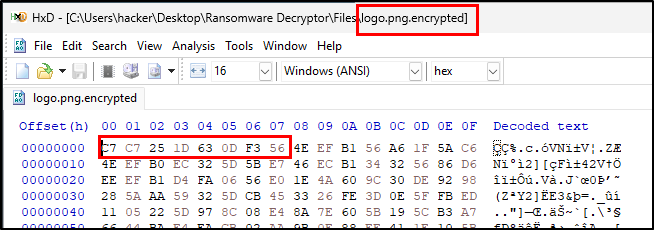
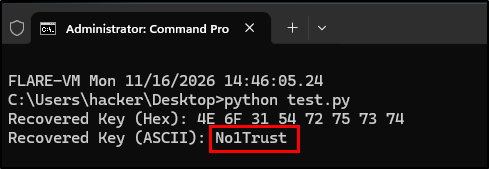
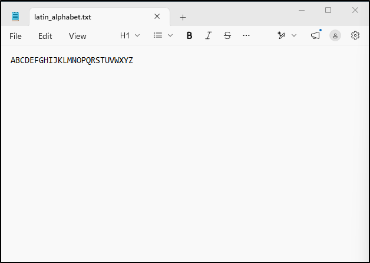

# Analyzing a Custom Ransomware Decryptor

## Overview
- **File Name:** `Decryptor.exe`
- **SHA-256:** `f087ff1a330a84e8a0b4d515fe56547eb8c93bd5b187586b0e7bd6b6f8b5e7c6`
- **Architecture:** 32-bit PE Executable
- **Goal:** Reverse engineer the decryptor to figure out how the key check or decryption routine works and recover the encrypted files.

---

## 1. Initial Execution & First Look

Before opening any static or dynamic analysis tools, I ran `Decryptor.exe` inside my isolated FLARE VM to see what it actually does. It pops up a red console window with a classic ransom note asking for 1 BTC, prints out a Base64 string, and asks for a decryption key:



Inside the `Files` folder right next to the binary, there are three encrypted files (`logo.png.encrypted`, `latin_alphabet.txt.encrypted`, and `cicero.txt.encrypted`). 

Just to see what happens, I typed in a random test key. The program actually creates the new files without the `.encrypted` extension, so there doesn't seem to be a strict password check blocking execution. However, opening `latin_alphabet.txt` shows complete gibberish instead of the alphabet, meaning the wrong key just decrypts the data into broken bytes:



*(Quick side note on the Base64 string in the console: decoding `KD4wXzApPiBJdCdzIGRhbmdlcm91cyB0byBhZZQrcm9yIGFsb25lISBUYWtlIHRoaXMgPCgwXzA8KQo=` translates to `(>0_0)> It's dangerous to go alone! Take this <(0_0<)`. It´s a nice little Zelda reference, though not the actual key.)*

---

## 2. Quick Triage (HxD & PEStudio)

Next, I did a quick check on the binary before diving into the disassembly:
- **HxD:** Opening `Decryptor.exe` in a hex editor shows the standard `4D 5A` (`MZ`) magic bytes at the very beginning, confirming it's a normal Windows PE file.
- **PEStudio:** Checking the file headers confirms it's a **32-bit executable**, and the imports look pretty minimal—mostly standard Windows API functions for console I/O (`ReadConsoleA`, `WriteConsoleA`) and file handling (`CreateFileA`, `ReadFile`, `WriteFile`, `FindFirstFileA`). No standard Windows CryptoAPI imports showed up, which is a strong hint that the author wrote a custom decryption routine.

---

## 3. Static Analysis in Ghidra

With that in mind, I loaded `Decryptor.exe` into Ghidra and jumped straight to the `entry` function:



In `entry`, the execution flow is pretty straightforward:
1. First, it grabs the console handles, sets the red background and yellow text via `SetConsoleTextAttribute`, and prints the ransom note using `WriteConsoleA`.
2. Next, `ReadConsoleA` reads up to **8 characters** (`nNumberOfCharsToRead = 8`) from our input into an 8-byte stack buffer (`local_14` and `local_10`).
3. Finally, it passes the address of that 8-byte input buffer straight into `FUN_00401370`.

Following a top-down approach, I jumped into `FUN_00401370` next to see how the key is used:



Here, the binary switches into the `Files` directory (`SetCurrentDirectoryA`) and loops through every file matching `*.encrypted` using `FindFirstFileA` and `FindNextFileA`. For each match, it copies the filename into `local_54` and strips the `.encrypted` extension by writing a null byte (`\0`) 10 characters before the end of the string. Both the encrypted source filename and the cleaned output filename are then passed along with our 8-byte key (`param_1`) into `FUN_00401220`.

Stepping into `FUN_00401220` shows the actual file-handling loop:



It opens the `.encrypted` file for reading and creates the new output file without the `.encrypted` extension. Inside a `while` loop, it reads the encrypted file in **8-byte chunks** into `local_1c`. Right before writing those 8 bytes to disk with `WriteFile`, it passes `local_1c` and our 8-byte user input (`param_3`) into `FUN_004011f0`.

Diving into `FUN_004011f0` finally revealed the core decryption routine:



The function iterates through the 8-byte chunk byte-by-byte (`i = 0` to `7`) and runs three simple operations on each byte:
1. **XOR:** It XORs the encrypted byte (`param_1[i]`) with the corresponding byte of our 8-character key (`param_2[i]`).
2. **Bitwise Rotate Left (ROL):** It rotates the bits of that result to the left by `i` positions (`bVar1 << (bVar2 & 7) | bVar1 >> 8 - (bVar2 & 7)`), wrapping the shifted-out bits back onto the right side.
3. **Index Subtraction:** Finally, it subtracts the current loop index `i` (`- bVar2`) and writes the resulting byte back into `param_1[i]`.

---

## 4. Known-Plaintext Attack & Key Recovery

Since the binary never validates the key against a stored hash or password and simply applies these three reversible operations to independent 8-byte blocks, it is completely vulnerable to a **Known-Plaintext Attack (KPA)**.

Looking back at the `Files` folder, one of the encrypted files is `logo.png.encrypted`. Every valid PNG file starts with the exact same 8-byte magic header:
- **Known Plaintext (`PNG` magic bytes):** `89 50 4E 47 0D 0A 1A 0A`

Opening `logo.png.encrypted` in **HxD** gives us the corresponding first 8 bytes of ciphertext:



- **Ciphertext (`logo.png.encrypted`):** `C7 C7 25 1D 63 0D F3 56`

To recover the 8-byte key, all we have to do is invert the three operations from `FUN_004011f0` in reverse order for each byte index `i = 0..7`:
1. **Add `i`** (inverse of `- i`)
2. **Rotate Right (`ROR`) by `i` bits** (inverse of `ROL`)
3. **XOR with the ciphertext byte** (since $A \oplus B = C \implies A \oplus C = B$)

I threw together a quick Python script to reverse the math:

```python
ciphertext = [0xC7, 0xC7, 0x25, 0x1D, 0x63, 0x0D, 0xF3, 0x56]
plaintext  = [0x89, 0x50, 0x4E, 0x47, 0x0D, 0x0A, 0x1A, 0x0A]  # PNG magic bytes

def ror8(val, shift):
    shift &= 7
    return ((val >> shift) | (val << (8 - shift))) & 0xFF

key = []
for i in range(8):
    t1 = (plaintext[i] + i) & 0xFF
    t2 = ror8(t1, i)
    key.append(t2 ^ ciphertext[i])

print("Recovered Key (Hex):", " ".join(f"{b:02X}" for b in key))
print("Recovered Key (ASCII):", "".join(chr(b) for b in key))
```

Running the script reversed the math and spit out the exact 8 key bytes in hex (`4E 6F 31 54 72 75 73 74`):



Translating those hex bytes to ASCII (`0x4E` = `N`, `0x6F` = `o`, `0x31` = `1`, `0x54` = `T`, `0x72` = `r`, `0x75` = `u`, `0x73` = `s`, `0x74` = `t`) gives us the final decryption key: **`No1Trust`**.

---

## 5. Verification

Now that I had the actual key, I ran `Decryptor.exe` again and typed in `No1Trust`. This time, opening `latin_alphabet.txt` showed the clean, readable alphabet instead of broken bytes, confirming that all files in the `Files` folder were properly decrypted:




## 6. Final Thoughts

Unlike typical malware samples where you have to spin up INetSim for C2 extraction or step through anti-analysis tricks in a debugger, this one could be solved almost entirely through static analysis. Combining basic static checks (PEStudio, HxD) with advanced static analysis in Ghidra was enough to map out the custom byte-level cipher, invert the math, and recover the key without ever needing dynamic unpacking.
